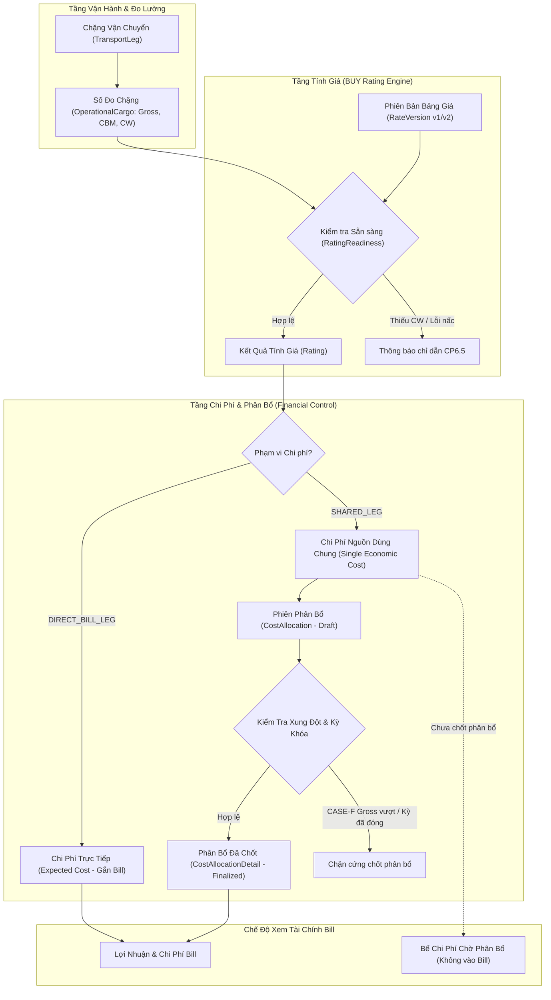

# BÁO CÁO ĐỐI CHIẾU AS-IS & THỰC THI KIẾN TRÚC CANONICAL (AS-IS MAPPING & IMPLEMENTATION REPORT)
**Mã gói phát hành:** `LCMS-UAT-CR-20261023-01` | **Phiên bản:** `v1.0 (23/10/2026)`  
**Dự án:** LCMS — Logistics Cost Management System  

---

## I. NGUYÊN TẮC BẢO TOÀN KIẾN TRÚC & ZERO SCHEMA MIGRATION

Tuân thủ nghiêm ngặt chỉ thị kỹ thuật của PO tại mục `1. QUY TẮC BÀN GIAO CẤM VI PHẠM` và mục kiểm tra `CK-01`:
1. **Zero Database Breaking Migration:** Không tạo thêm bảng vật lý mới, không đổi tên cột canonical, không phá vỡ tính tương thích ngược cho cả 3 kênh: Nhập thủ công (Manual UI), Import Excel, và Tích hợp API (Integration).
2. **Reuse Canonical Entities:** Tái sử dụng tối đa các thực thể và quan hệ chuẩn có sẵn trong domain `LCMS.Domain` và tầng dữ liệu `LCMS.Infrastructure`:
   - `TransportLeg`: Quản lý thực thể Chặng vận chuyển, lộ trình, hãng vận chuyển.
   - `OperationalCargo`: Quản lý số đo hàng hóa (Gross, CBM, CW), mở rộng cho phép đối tượng cha là `ParentType = "Leg"` bên cạnh `Bill`, `Order`, `Shipment`.
   - `Cost`: Quản lý nghĩa vụ tài chính kinh tế, hỗ trợ phân loại `AttributionType` (`Direct` vs `Shared`) và độ trưởng thành `FinancialMaturity` (`Expected`, `Confirmed`, `Actual`).
   - `CostAllocation` & `CostAllocationDetail`: Quản lý các phiên phân bổ chi phí Chặng và chi tiết số tiền phân bổ cho từng Bill.
   - `RateVersion`, `PricingRule`, `RateBreak`, `ContainerRatePrice`: Quản lý phiên bản bảng giá và cấu trúc tính giá.

---

## II. BẢNG ĐỐI CHIẾU AS-IS CHI TIẾT (CANONICAL MAPPING MATRIX)

| Logical Concept (PO/BA Contract) | Canonical Entity / Database Table | DTO / Command / Query Tương Ứng | Trạng thái AS-IS & Hướng Hiện Thực Hóa |
| :--- | :--- | :--- | :--- |
| **Bill – Order N:N Link** | `Bill` (`bills`), `Order` (`orders`), `BillOrder` | `UpdateBillOrdersCommand`, `GetBillByIdQuery` | **Tái sử dụng hoàn toàn:** Giữ quan hệ nhiều-nhiều độc lập, bảo toàn Customer của Bill không bị ghi đè. |
| **Bill – Shipment N:N Link** | `Bill` (`bills`), `Shipment` (`shipments`) | `UpdateBillShipmentsCommand`, `GetBillByIdQuery` | **Tái sử dụng hoàn toàn:** Lưu vết liên kết bền vững, kiểm tra dependency trước khi gỡ. |
| **Leg Measurements (Gross/CBM/CW)** | `OperationalCargo` (`operational_cargos`), `TransportLeg` | `OperationalCargo`, `SetLegMeasurementsCommand` | **Mở rộng an toàn:** Bổ sung `"Leg"` vào danh sách cha hợp lệ `OperationalObjectTypes.CargoParents`. Không cần migration. |
| **Leg Chargeable Weight (CW)** | `OperationalCargo.ChargeableWeight`, `TransportLeg.ChargeableWeight` | `RateCalculationRequest`, `RatingReadiness` | **Tái sử dụng:** Hỗ trợ 3 nguồn: `manual`, `derived`, `cargo_split`. Kiểm tra tính sẵn sàng trước khi Rating. |
| **Rate Version Draft v2** | `RateVersion` (`rate_versions`) | `CreateRateVersionCommand(RateCardId, ..., CloneFromVersionId)` | **Bổ sung logic sao chép:** Khi `CloneFromVersionId` có giá trị, tự động clone toàn bộ `PricingRules`, `RateBreaks`, `Components` từ v1 sang v2. |
| **Rate Version Immutability** | `RateVersion.Status = "published"` | `PublishRateVersionCommand` | **Tái sử dụng & Thắt chặt:** Chặn sửa khi đã Publish; kiểm tra xung đột nấc và xung đột chế độ (Mixed Mode). |
| **BUY Rating Scope (Direct vs Shared)** | `Rating.ContextJson`, `Cost.AttributionType` | `CreateRatingCommand(..., CostScope)`, `SeedExpectedCostsFromRatingCommand` | **Hiện thực hóa Single Economic Cost:** Đóng dấu scope vào ngữ cảnh; tái sử dụng chi phí nguồn chung trên Chặng cho tất cả các Bill cùng đi qua. |
| **Cost Allocation Session** | `CostAllocation` (`cost_allocations`) | `CreateCostAllocationCommand`, `FinalizeCostAllocationCommand` | **Tái sử dụng D05:** Phân bổ theo cơ sở CW/Gross/CBM; bảo toàn 100% chi phí nguồn; xử lý sai số làm tròn. |
| **Physical Gross Conflict Gate** | Validation trong `AllocationCommands.cs` | `FinalizeCostAllocationCommandHandler` | **Bổ sung Hard Block (CASE-F):** Chặn chốt phân bổ nếu tổng Gross các Bill vượt Gross thực tế của Chặng. |
| **Closed Period Lock Gate** | `IPeriodLockGate` (`period_locks`) | `FinalizeCostAllocationCommandHandler` | **Tích hợp bảo vệ sổ sách tài chính:** Kiểm tra kỳ đóng sổ trước khi chốt phân bổ, ném `PeriodLockedAppException`. |

---

## III. SƠ ĐỒ KIẾN TRÚC & LUỒNG DỮ LIỆU ĐIỀU HÀNH (DATA FLOW)



---

## IV. BẢO TOÀN TÍNH KINH TẾ (SINGLE ECONOMIC COST GUARANTEE)

```csharp
// Trích đoạn mã nguồn bảo vệ Single Economic Cost tại SeedExpectedCostsFromRatingCommand.cs
if (isSharedLeg && legId.HasValue)
{
    // Tìm kiếm xem Chặng này đã có chi phí kinh tế nguồn cho nghĩa vụ này chưa
    var existingCost = await _db.Costs.FirstOrDefaultAsync(c =>
        c.LegId == legId.Value &&
        c.AttributionType == CostAttributionTypes.Shared &&
        c.SupplierPartyId == vendorPartyId &&
        c.ChargeCode == chargeCode &&
        c.DeletedAt == null, cancellationToken);

    if (existingCost != null)
    {
        // TÁI SỬ DỤNG CHI PHÍ NGUỒN HIỆN HỮU — TUYỆT ĐỐI KHÔNG SINH TRÙNG CHI PHÍ KINH TẾ
        return existingCost.Id;
    }
}
```

Nhờ cơ chế này, cho dù người dùng mở 10 Bill khác nhau cùng tham gia trên một Chặng hàng gom và bấm "Tính giá mua", hệ thống chỉ ghi nhận **duy nhất 1 khoản chi phí nguồn** trong cơ sở dữ liệu. Sau đó, khoản chi phí này được phân bổ minh bạch cho từng Bill qua bảng `cost_allocation_details`.
