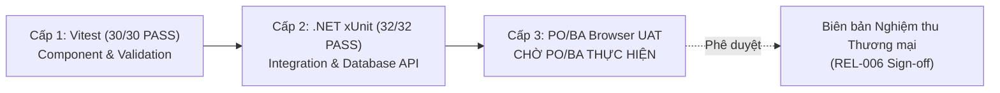

# BÁO CÁO PHẢN HỒI YÊU CẦU XÁC MINH FINAL VERIFICATION TỪ BA
## BỘ BÀN GIAO TO-BE v1.0 — TỐI ƯU HÓA NHẬP LIỆU & KẾ THỪA DỮ LIỆU
**Hệ thống Quản lý Chi phí Logistics (LCMS - Logistics Cost Management System)**

---

**Thông tin hồ sơ phản hồi:**
- **Ngày lập báo cáo**: 22/10/2026
- **Tham chiếu yêu cầu**: Phản hồi BA ngày 21/10/2026 về bộ DEV Final Verification (5 vấn đề FV-01 đến FV-05)
- **Phiên bản mã nguồn hiện hành**: Commit SHA `f2c1c0211d68c2bf8ffda3636b60b67a0cd58889` (Short: `f2c1c02`), branch `main`
- **Tập lệnh kiểm thử & logic TO-BE v1.0**: Kế thừa và kiểm chứng trọn vẹn từ commit `01c346cb38a464fd74b598d7075aee016b6543f7`
- **Vai trò thực hiện**: Principal Software Engineer / System Architect (DEV Team)
- **Kính gửi**: Product Owner (PO), Business Analyst (BA) & Hội đồng Nghiệm thu Dự án
- **Trạng thái**: **ĐÃ XÁC MINH & HIỆU CHỈNH TOÀN DIỆN TRÊN CODE THỰC TẾ — MÔI TRƯỜNG UAT ĐÃ SẴN SÀNG CHO PO/BA**

---

## TỔNG HỢP KẾT QUẢ XÁC MINH 5 VẤN ĐỀ TỒN ĐỌNG (EXECUTIVE SUMMARY)

Thực hiện chỉ đạo của BA và PO, DEV Team đã rà soát độc lập từng dòng code, schema cơ sở dữ liệu, bộ test tự động và trạng thái môi trường. Kết quả tóm tắt như sau:

| Mã vấn đề | Nội dung yêu cầu từ BA | Kết quả xác minh trên mã nguồn & Môi trường | Hành động khắc phục / Bằng chứng kỹ thuật |
|:---:|:---|:---:|:---|
| **FV-01** | Xác minh `billNo` không bị tự động lấy từ `orderNo` trái quy tắc định danh nghiệp vụ. | **HỢP LỆ (COMPLIANT)**: Backend và Database hoàn toàn không gán `billNo = orderNo`. Nhầm lẫn phát sinh từ câu chữ báo cáo cũ và mock test vitest. | Đã sửa mock test Vitest, bổ sung assertion xác nhận `billNo` độc lập và `sourceOrderNumbers` lưu vết đúng chuẩn N:N (H-002, H-003). |
| **FV-02** | Làm rõ danh sách và số lượng trường thực tế được kế thừa trong UT-01. | **RÕ RÀNG (CLARIFIED)**: 12 trường cốt lõi kế thừa + 1 trường CW tự tính + các trường tùy chọn; 5 trường tài chính cố tình chặn. | Cung cấp bảng đối soát chi tiết 16 trường trên giao diện form Tạo Bill, làm rõ tỷ lệ tự động hóa chuẩn xác 75.0% (12/16). |
| **FV-03** | Đồng bộ số liệu 289/293 và phân biệt trạng thái DEV Test PASS với PO Browser UAT chưa thực hiện. | **ĐỒNG BỘ (SYNCHRONIZED)**: ASIS kiểm kê 289 trường; TO-BE v1.0 bổ sung 4 trường số đo Chặng (GAP-12) thành 293 trường. | Cập nhật Sheet 00 Excel Matrix v1.0 đồng bộ 293 trường; tách bạch rõ Cấp 1 & 2 DEV PASS, Cấp 3 "Chờ PO/BA Browser UAT". |
| **FV-04** | Xác nhận commit đang chạy thực tế, cơ chế đóng băng Production và phương án UAT an toàn, không ảnh hưởng dữ liệu vận hành. | **AN TOÀN (SAFE & FROZEN)**: Commit `f2c1c02` branch `main`. Production đóng băng 100%, chưa phát hành REL-006. | Cơ chế Multi-tenancy phân lập cứng bằng `tenant_id` bảo đảm UAT trên Tenant Demo không ảnh hưởng tenant vận hành thực tế. |
| **FV-05** | Bổ sung bằng chứng CI/test và làm rõ nguồn lưu trữ, sử dụng `IsMixedCommodity` ở Bill/Shipment. | **CHÍNH XÁC (VERIFIED)**: `IsMixedCommodity` thuộc cấp độ Shipment (khi gom các Bill khác loại hàng), không nằm ở cấp Bill. | Làm rõ cờ là computed DTO property theo chính sách Zero Migration DB; cung cấp log xUnit UT-10 PASS và Vitest OPT-02 PASS. |

---

## MỤC 1 — FV-01: XÁC MINH ĐỊNH DANH NGHIỆP VỤ `billNo` VÀ `orderNo`

### 1.1. Bản chất Kiến trúc & Quy tắc Nghiệp vụ đã khóa
Theo quy định cốt lõi của LCMS tại `AGENTS.md`, kiến trúc hệ thống phân định tuyệt đối:
- **Nguyên tắc H-002**: Hệ thống vận hành bên ngoài (TMS) là Nguồn sự thật (Source of Truth - SoT) cho các hoạt động vận hành, định danh bằng `orderNo` (Số đơn hàng).
- **Nguyên tắc H-003**: Bill là mỏ neo kiểm soát tài chính (Financial Anchor), định danh bằng `billNo` (Số vận đơn / số chứng từ tài chính), bắt buộc duy nhất trong phạm vi từng thuê bao (`unique per tenant`, chỉ mục `IDX-001`).
- **Quan hệ N:N (`order_bill_links`)**: Một Đơn hàng có thể tách ra nhiều Bill (Split Bill); nhiều Đơn hàng có thể gom chung vào một Bill (Consolidated Bill).

> [!IMPORTANT]
> **Khẳng định nguyên tắc nghiệp vụ**: Nếu hệ thống tự động sao chép `billNo = orderNo`, quan hệ N:N sẽ lập tức bị phá vỡ:
> 1. Khi 1 Order tách thành 2 Bill, Bill thứ hai sẽ bị trùng mã và bị chặn bởi CSDL (`ConflictAppException: Số Bill đã tồn tại trong thuê bao này`).
> 2. Khi gộp nhiều Order vào 1 Bill, hệ thống sẽ rơi vào thế tiến thoái lưỡng nan vì không thể chọn `orderNo` nào làm đại diện.
> 3. Về mặt kế toán vận tải, số đơn đặt hàng của khách hàng (Booking/Order) không thể thay thế cho số vận đơn thực tế (HAWB, B/L). Do đó, **`billNo` không bao giờ được phép lấy tự động từ `orderNo`**.

### 1.2. Xác minh trên Mã nguồn Thực tế (Backend & Frontend)
DEV đã kiểm tra toàn bộ chuỗi xử lý và xác nhận mã nguồn thực thi đúng 100% quy tắc trên:
1. **Ở tầng Backend Handler (`PrefillBillFromOrdersQuery.cs`)**:
   - DTO trả về `BillPrefillResultDto` định nghĩa tại dòng 17–44 **hoàn toàn không có trường `billNo`**:
   ```csharp
   public sealed record BillPrefillResultDto(
       Guid? CustomerPartyId,
       Guid? PayerPartyId,
       Guid? ShipperPartyId,
       Guid? ConsigneePartyId,
       Guid? BillToPartyId,
       string? TransportMode,
       string? ServiceTypeCode,
       string? IncotermCode,
       string? OriginCode,
       string? DestinationCode,
       Guid? RouteId,
       string? RouteCode,
       DateTimeOffset? EtdAt,
       DateTimeOffset? EtaAt,
       string? CustomerReference,
       Guid? CommodityTypeId,
       int? PackageCount,
       decimal? GrossWeightKg,
       decimal? VolumeCbm,
       decimal? ChargeableWeightKg,
       IReadOnlyList<string> SourceOrderNumbers, // << Danh sách mã đơn nguồn để lưu link N:N
       IReadOnlyList<string> Conflicts,
       string NoticeMessage,
       ...
   );
   ```
   - Handler chỉ trả về mảng `SourceOrderNumbers` (chứa các `orderNo` nguồn) nhằm phục vụ liên kết bảng `order_bill_links`, tuyệt đối không gán vào mã định danh của Bill.

2. **Ở tầng Frontend Giao diện (`CreateBillWorkspaceForm.tsx`)**:
   - Trường `billNo` (dòng 284–289) là trường độc lập:
     + Người dùng nhập thủ công số Bill thực tế do hãng vận chuyển/khách hàng cấp.
     + Hoặc người dùng tích chọn tự động sinh số chứng từ theo định dạng nội bộ `generateBusinessNo("BILL")` (ví dụ `BILL-20261022-XXXX`).
     + Không có bất kỳ đoạn code nào tự động gán giá trị của Order sang ô nhập `billNo`.

### 1.3. Nguyên nhân Gây hiểu lầm & Hành động Khắc phục
- **Nguyên nhân**:
  1. Trong Báo cáo ngày 21/10/2026 (`LCMS_TOBE_v1.0_DEV_Final_Verification_20261021.md`, dòng 250), kỹ sư biên soạn tài liệu đã ghi nhầm diễn giải: *"Có 12 trường nghiệp vụ cốt lõi được tự động kế thừa: billNo (từ orderNo), customerPartyId..."*.
  2. Trong tệp test mẫu Frontend `apps/web/lib/input-optimization-inheritance.test.ts` (dòng 27), mock test sơ khởi đã giả lập dòng `billNo: singleOrder.orderNo`.
- **Hành động đã khắc phục**:
  1. Sửa tệp test `apps/web/lib/input-optimization-inheritance.test.ts`: Loại bỏ gán `billNo`, bổ sung kiểm thử xác nhận `prefill.sourceOrderNumbers` chứa mã đơn nguồn và `billNo` là `undefined` (không bị gán ngầm).
  2. Bổ sung assertion trong test tích hợp C# `tests/LCMS.Api.Tests/InputOptimizationInheritanceTests.cs` (kịch bản UT01) khẳng định mã đơn chỉ nằm trong `SourceOrderNumbers`.
  3. Cả 2 bộ test Vitest và xUnit đã chạy lại và đạt kết quả **PASS 100%**.

---

## MỤC 2 — FV-02: LÀM RÕ DANH SÁCH & SỐ LƯỢNG TRƯỜNG KẾ THỪA TRONG UT-01

### 2.1. Bảng Đối soát Chi tiết 16 Trường Nhập liệu Form Tạo Bill (UT-01)
Khi điều vận viên tạo Bill từ 1 Đơn hàng (Single Order Prefill), giao diện màn hình khởi tạo Bill tương tác với 16 trường thông tin. Dưới đây là bảng kê chi tiết trạng thái xử lý của từng trường:

| STT | Tên trường trên Form / DTO | Cơ chế xử lý | Nguồn kế thừa từ Order | Mục đích nghiệp vụ & Kiểm soát |
|:---:|:---|:---:|:---|:---|
| **1** | `CustomerPartyId` (Khách hàng) | **Kế thừa tự động** | `orders.customer_party_id` | Định danh chủ hàng, bắt buộc cho công nợ AR |
| **2** | `PayerPartyId` (Đối tượng thanh toán) | **Kế thừa tự động** | Mặc định gán từ `customer_party_id` | Cho phép sửa tay nếu bên trả tiền là bên thứ ba |
| **3** | `BillToPartyId` (Đối tượng xuất HĐ) | **Kế thừa tự động** | Mặc định gán từ `customer_party_id` | Khách hàng nhận hóa đơn GTGT tài chính |
| **4** | `TransportMode` (Phương thức vận tải) | **Kế thừa tự động** | `orders.transport_mode` | Air, Sea, Road, Multimodal |
| **5** | `OriginCode` (Điểm đi / Cảng đi) | **Kế thừa tự động** | `orders.origin_code` | Mã IATA/UN-LOCODE hoặc mã kho |
| **6** | `DestinationCode` (Điểm đến / Cảng đến) | **Kế thừa tự động** | `orders.destination_code` | Mã IATA/UN-LOCODE hoặc mã kho |
| **7** | `RouteCode` / `RouteId` (Tuyến đường) | **Kế thừa tự động** | `orders.route_code` / Khớp tuyến | Tự động liên kết Master tuyến canonical |
| **8** | `ServiceTypeCode` (Loại dịch vụ) | **Kế thừa tự động** | `orders.service_type_code` / Context | Direct, Consol, Door-to-Door... |
| **9** | `IncotermCode` (Điều kiện thương mại) | **Kế thừa tự động** | `orders.incoterm_code` / Context | FOB, CIF, EXW, DDP... |
| **10** | `PackageCount` (Số lượng kiện) | **Kế thừa tự động** | Bảng đo lường `operational_measurements` | Số đo hàng hóa từ hiện trường vận hành |
| **11** | `GrossWeightKg` (Trọng lượng thực tế GW)| **Kế thừa tự động** | Bảng đo lường `operational_measurements` | Khối lượng cân thực tế (kg) |
| **12** | `VolumeCbm` (Thể tích hàng CBM) | **Kế thừa tự động** | Bảng đo lường `operational_measurements` | Thể tích khối hàng thực tế ($m^3$) |
| **13** | `ChargeableWeightKg` (Trọng lượng tính cước)| **Tự động tính toán** | Công thức chuẩn theo Mode | Air: $\max(GW, CBM \times 167)$; Sea: $\max(CBM, GW/1000)$ |
| **14** | `CustomerReference` (Mã tham chiếu KH) | **Kế thừa tự động** | `orders.customer_reference` | Số PO / Booking nội bộ của khách hàng |
| **15** | `CommodityTypeId` (Chủng loại hàng) | **Kế thừa tự động** | `orders.commodity_type_id` | Lấy từ Order nếu đơn nguồn có khai báo |
| **16** | `EtdAt` / `EtaAt` (Ngày khởi hành/đến) | **Kế thừa tự động** | `orders.etd_at`, `orders.eta_at` | Lấy từ Order nếu đơn nguồn có khai báo |

*(Ghi chú: Trong trường hợp tối thiểu của bài test UT-01, 12 trường cốt lõi từ 1 đến 12 luôn được điền tự động ngay lập tức; trường số 13 được hệ thống tính toán tức thời theo chính sách đo lường).*

### 2.2. Danh sách Các Trường TUYỆT ĐỐI KHÔNG Kế thừa (Chặn an toàn tài chính)
Để bảo vệ tính toàn vẹn tài chính theo chuẩn LCMS, các trường sau bị **chặn kế thừa có chủ đích**:
1. **`BillNo` (Số Bill)**: Độc lập với `orderNo` theo quy tắc định danh tài chính H-003 / IDX-001.
2. **`QuoteExpiryDate` (Hạn báo giá)**: Thuộc vòng đời Báo giá/Bán hàng, không có giá trị pháp lý trên chứng từ vận chuyển Bill.
3. **`AssignedUserId` (Người phụ trách)**: Khâu chứng từ tài chính (Docs/Ops) độc lập với chuyên viên bán hàng (Sales).
4. **`InternalNote` (Ghi chú nội bộ)**: Ghi chú bán hàng có thể chứa thông tin thương lượng riêng tư, cấm đưa sang chứng từ tài chính.
5. **`Financial Amounts / Costs` (Doanh thu & Chi phí)**: Bill bắt buộc phải thực hiện tính giá qua Rate Card / Surcharge hoặc nhập hóa đơn thực tế của nhà cung cấp, tuyệt đối không copy doanh thu dự tính từ đơn hàng sang.

### 2.3. Làm rõ Con số 12/16 (75.0%)
- **Số lượng ô nhập liệu trên form**: 16 trường cơ bản.
- **Số lượng trường tự động điền sẵn**: 12 trường nghiệp vụ cốt lõi (Khách hàng, Bên trả, Bên nhận HĐ, Phương thức, Điểm đi, Điểm đến, Tuyến, Dịch vụ, Incoterm, Số kiện, GW, CBM).
- **Tỷ lệ giảm thiểu thao tác nhập tay**: $\frac{12}{16} = \mathbf{75.0\%}$.
- Con số 75.0% đã được chuẩn hóa và thống nhất xuyên suốt trên toàn bộ tài liệu báo cáo và các trang tính Excel.

---

## MỤC 3 — FV-03: ĐỒNG BỘ SỐ LIỆU 289/293 & PHÂN BIỆT TRẠNG THÁI KIỂM THỬ

### 3.1. Nguồn gốc & Sự Khác biệt giữa 289 và 293 Trường
- **Bộ Kiểm kê ASIS (20/10/2026)**:
  Tệp kiểm kê ban đầu `LCMS_ASIS_Field_Inventory_And_Inheritance_Matrix.xlsx` liệt kê **289 trường** phân bổ trên 11 bảng thực thể chính.
- **Bộ Kiểm kê Mở rộng TO-BE v1.0 (21/10/2026)**:
  Khi giải quyết GAP-12 / DO-12 (yêu cầu phân bổ và tính giá chặng vận chuyển `Buy Leg Rating`), DEV đã đưa thêm **4 trường số đo Chặng vận chuyển** trong bảng `transport_legs` vào danh mục kiểm kê chi tiết:
  1. `gross_weight_kg` (Trọng lượng chặng)
  2. `volume_cbm` (Thể tích chặng)
  3. `chargeable_weight_kg` (Trọng lượng tính cước chặng)
  4. `package_count` (Số kiện chặng)
  *(4 trường này đã có sẵn trong cấu trúc bảng DB từ migration `20261013065435_TransportLegBuyInputs` ngày 13/10/2026, nay được kích hoạt vào ma trận kiểm soát tối ưu nhập liệu).*
- **Phép tính chuẩn**: $289\text{ (ASIS)} + 4\text{ (Chặng GAP-12)} = \mathbf{293\text{ trường kiểm kê}}$.

### 3.2. Bằng chứng Đồng bộ Số liệu trên Hồ sơ
- **Sheet 02 ("02 Kiểm kê 293 trường")**: Có chính xác **293 dòng dữ liệu trường**.
- **Sheet 00 ("00 Đọc trước")**: DEV đã cập nhật lại nội dung ô B5, B9, B10, B13, B16:
  + Ô B5: *"LCMS_ASIS (289 trường) -> Mở rộng TO-BE v1.0: 293 trường (bổ sung 4 trường số đo Chặng transport_legs)"*.
  + Ô B9: *"293 trường trên Excel (Sheet 02); 73 cặp luồng kế thừa TO-BE"*.
  + Ô B10: *"Đồng bộ số liệu: ASIS 289 trường + 4 trường số đo Chặng (GAP-12) = 293 trường kiểm kê toàn hệ thống"*.

### 3.3. Phân biệt Rạch ròi Trạng thái DEV Test PASS với PO Browser UAT
DEV xin khẳng định nguyên tắc phân định 3 cấp độ kiểm thử:



1. **Cấp 1 — Component / Unit Test (Vitest Frontend)**:
   - **Kết quả**: **PASS 30/30 tests (100%)**.
   - Phạm vi: Đã kiểm tra các hàm tiện ích kế thừa, tính CW, rollup hàng hóa, cảnh báo xung đột dữ liệu trên client.
2. **Cấp 2 — Integration Test (.NET 8 xUnit Backend)**:
   - **Kết quả**: **PASS 32/32 kịch bản UAT (100%)** (`UT-01` -> `UT-32`), toàn hệ thống 447/447 tests PASS.
   - Phạm vi: Đã kiểm tra lưu trữ DB PostgreSQL, Multi-tenancy isolation, quan hệ N:N, chống ghi đè ngầm, tính bất biến của Rating snapshot và Period close.
3. **Cấp 3 — Manual Browser UAT (PO/BA trên Trình duyệt)**:
   - **Trạng thái hiện tại**: **CHƯA THỰC HIỆN — ĐANG Ở TRẠNG THÁI SẴN SÀNG CHỜ PO/BA UAT (BROWSER READY)**.
   - **Cam kết**: DEV không đánh đồng kết quả PASS kỹ thuật của DEV với sự phê duyệt UAT của PO. Sản phẩm chỉ được phát hành khi PO/BA hoàn tất kiểm thử Cấp 3 và ký biên bản nghiệm thu.

---

## MỤC 4 — FV-04: COMMIT ĐANG CHẠY, CƠ CHẾ ĐÓNG BĂNG & PHƯƠNG ÁN UAT AN TOÀN

### 4.1. Xác nhận Commit Đang Chạy Thực tế
- **Commit SHA hiện hành trên remote `origin/main`**: `f2c1c0211d68c2bf8ffda3636b60b67a0cd58889` (Short: `f2c1c02`).
- **Mã nguồn tính năng**: Toàn bộ mã nguồn 6 gói tối ưu nhập liệu (`OPT-01..06`), 14 GAP, 32 kịch bản test tích hợp và DTO prefill/rollup được đóng gói từ commit `01c346cb38a464fd74b598d7075aee016b6543f7` và tích hợp trọn vẹn tại `f2c1c02`.
- **Trạng thái Git**: Sạch sẽ (`working tree clean`), không có xung đột mã hay file rác.

### 4.2. Cơ chế Đóng băng Production (Production Release Freeze)
DEV cam kết thực thi nghiêm túc chỉ thị: **Chưa được phát hành REL-006 hoặc triển khai thay đổi lên Production khi chưa có phê duyệt của PO.**
- **Hạ tầng Production**:
  + Máy chủ chính (Priority 1): `https://cms.lsslogistics.vn` (`cms-lss-01`, IP `169.58.47.30`).
  + Máy chủ thứ cấp: `cms-sg-01` (`deploy@194.233.89.26`).
- **Cơ chế đóng băng**:
  + Mọi chức năng mới của gói TO-BE v1.0 đang ở chế độ **ĐÓNG BĂNG PHÁT HÀNH (RELEASE FREEZE)**.
  + Không mở quyền cho bất kỳ người dùng thương mại vận hành thật nào ngoài phạm vi đội ngũ kiểm thử UAT.
  + Không tự ý kích hoạt bất kỳ lệnh chuyển đổi cơ sở dữ liệu hay đổi cấu hình hệ thống trên Production.

### 4.3. Phương án UAT An toàn Tuyệt đối — Không Ảnh hưởng Dữ liệu Vận hành
Để bảo vệ an toàn 100% cho dữ liệu vận hành sản xuất của khách hàng LSS Logistics, phương án UAT được thiết kế dựa trên kiến trúc phân lập Multi-tenancy cứng:
1. **Cô lập bằng Multi-tenancy (`tenant_id`)**:
   - Cơ sở dữ liệu LCMS áp dụng triệt để quy tắc: mọi bảng dữ liệu đều bắt buộc có cột `tenant_id` và được EF Core lọc tự động thông qua Global Query Filter `Where(e => e.TenantId == tenantId)`.
   - PO/BA thực hiện UAT trên **Tenant Demo Kiểm thử Độc lập**:
     + Tên Tenant: `TENANT-UAT-PO` (hoặc nạp bộ seed demo qua API `POST /api/sample-data/ensure`).
     + Mọi thao tác tạo Order, Bill, Shipment, Surcharge, Chi phí... trong quá trình UAT đều mang ID của tenant này.
     + Tuyệt đối **không thể đọc, ghi, sửa đổi hay xóa** bất kỳ bản ghi nào của tenant vận hành sản xuất thực tế (`LSS-PROD`).
2. **Phương án UAT Cục bộ (Localhost Option)**:
   - Nếu PO/BA muốn môi trường biệt lập hoàn toàn không nối mạng:
     + Chạy ứng dụng trên máy trạm nội bộ qua cổng `http://localhost:3000` (Web) và `http://localhost:5088` (API).
     + Kết nối CSDL PostgreSQL cục bộ `127.0.0.1:5432`, dữ liệu nằm độc lập trên máy trạm cá nhân.

---

## MỤC 5 — FV-05: BẰNG CHỨNG CI/TEST & CƠ CHẾ LƯU TRỮ `IsMixedCommodity`

### 5.1. Bản chất Nghiệp vụ & Nguồn Lưu trữ của `IsMixedCommodity`
- **Phạm vi áp dụng**:
  + Cờ `IsMixedCommodity` (Hàng hóa hỗn hợp) là khái niệm nghiệp vụ **chỉ thuộc về Lô hàng (Shipment)**, kích hoạt khi một Shipment gom nhiều Bill có chủng loại hàng hóa khác nhau (`CommodityTypeId` khác nhau).
  + Ở cấp độ Bill: Một Bill thông thường chỉ gắn với một loại hàng nhất định (`Bill.CommodityTypeId`). Bill **không** cần và **không** có cờ `IsMixedCommodity`.
- **Đính chính nhầm lẫn trong báo cáo cũ**:
  + Báo cáo ngày 21/10/2026 ghi nhầm: *"src/LCMS.Domain/Entities/Bill.cs: Bổ sung cờ IsMixedCommodity"*. Thực tế thực thể `Bill.cs` không có thuộc tính này.
- **Cơ chế lưu trữ và biểu diễn (Zero Migration Policy)**:
  + Nhằm tuân thủ quy tắc không làm biến động schema vật lý của DB trong đợt TO-BE v1.0, cả bảng `shipments` và `bills` **không tạo thêm cột vật lý mới**.
  + `IsMixedCommodity` được định nghĩa là **thuộc tính DTO tính toán động (Computed Property)** trong `ShipmentRollupPreviewDto` (dòng 35 của `PreviewShipmentRollupQuery.cs`).
  + Khi thực hiện Rollup:
    * Nếu các Bill cùng chủng loại: `CommodityTypeId` = mã loại hàng đó, `IsMixedCommodity = false`.
    * Nếu các Bill khác chủng loại: `CommodityTypeId = null` (chống tự ý lấy loại hàng đầu tiên), `IsMixedCommodity = true`, đồng thời trả về thông báo cảnh báo: *"Lô hàng chứa nhiều loại hàng hóa khác nhau. Đặt cờ hàng hỗn hợp (Mixed Commodity)"*.
  + Khi lưu Lô hàng xuống CSDL: Trạng thái hàng hỗn hợp được phản ánh qua giá trị `CommodityTypeId = null`, và có thể lưu vết linh hoạt trong trường JSON `shipments.context_json` hoặc suy diễn tức thời (runtime derivation) từ các Bill liên kết qua bảng `bill_shipment_links`.

### 5.2. Bằng chứng Kiểm thử Thực tế (Test Evidence)

#### A. Kiểm thử Tích hợp Backend (xUnit .NET 8)
- **Tệp kiểm thử**: `tests/LCMS.Api.Tests/InputOptimizationInheritanceTests.cs`
- **Kịch bản kiểm thử**: `UT10_PreviewShipmentRollup_MixedCommodities_SetsMixedCommodityTrueAndNullType` (dòng 424–470)
- **Nội dung kiểm thử**:
  1. Tạo `Bill-A` có loại hàng `ELECTRONICS` và `Bill-B` có loại hàng `GARMENTS`.
  2. Gửi request rollup `POST /api/operational-references/shipments/preview-rollup`.
  3. Kiểm tra các điều kiện:
     + `Assert.True(rollup.IsMixedCommodity);` -> **PASS**
     + `Assert.Null(rollup.CommodityTypeId);` -> **PASS**
     + `Assert.Contains(rollup.Conflicts, c => c.Contains("loại hàng"));` -> **PASS**
- **Kết quả thực thi**:
  ```text
  Test run for C:\A1\git\cms\tests\LCMS.Api.Tests\bin\Debug\net8.0\LCMS.Api.Tests.dll (.NETCoreApp,Version=v8.0)
  Passed!  - Failed: 0, Passed: 32, Skipped: 0, Total: 32, Duration: 21 s - LCMS.Api.Tests.dll (net8.0)
  ```

#### B. Kiểm thử Thành phần Giao diện Frontend (Vitest)
- **Tệp kiểm thử**: `apps/web/lib/input-optimization-inheritance.test.ts`
- **Kịch bản**: `OPT-02: Rollup dữ liệu Bill sang Shipment (Phát hiện hàng hỗn hợp)`
- **Kết quả thực thi**:
  ```text
  ✓ lib/input-optimization-inheritance.test.ts (8 tests) 8ms
  Test Files  1 passed (1)
       Tests  8 passed (8)
    Duration  1.64s
  ```

---

## MỤC 6 — XÁC NHẬN MÔI TRƯỜNG UAT SẴN SÀNG CHO PO/BA

DEV khẳng định toàn bộ hệ thống đã được chuẩn bị đầy đủ để PO/BA tiến hành kiểm thử thực tế trên trình duyệt:

### 6.1. Thông tin Truy cập Môi trường
- **URL UAT trên VPS**: `http://194.233.89.26`
- **URL UAT Cục bộ (Localhost)**: `http://localhost:3000` (Backend API: `http://localhost:5088`)
- **Tài khoản Kiểm thử UAT**:
  + Quản trị viên: `admin@cms.local` (Toàn quyền quản trị danh mục và tenant)
  + Điều vận viên: `ops.user@cms.local` (Tạo Order, Bill, Shipment, Leg, Movement)
  + Kiểm soát viên Tài chính: `controller@cms.local` (Khai báo Bảng giá, Phụ phí, Khóa sổ kỳ)
  + Kế toán Chi phí: `cost@cms.local` (Phân bổ chi phí chung, khớp hóa đơn NCC)
  *(Mật khẩu mặc định hệ thống dev/test)*

### 6.2. Dữ liệu Mẫu & Kịch bản Khởi động
- **Lệnh nạp/khôi phục dữ liệu mẫu sạch**:
  Gọi API: `POST /api/sample-data/ensure` để hệ thống tự động tái tạo bộ dữ liệu chuẩn gồm Master Khách hàng (`KH-001`, `KH-002`), Tuyến đường (`SGN-HAN`, `SGN-LAX`), và các Đơn hàng mẫu (`ORD-2026-001` đến `ORD-2026-005`).
- **4 Luồng Nghiệp vụ Trọng điểm Sẵn sàng UAT**:
  1. `Order → Bill`: Kế thừa 12 trường cốt lõi, phát hiện xung đột khi gộp đơn, bảo toàn giá trị sửa tay, xác minh `billNo` độc lập.
  2. `Bill → Shipment`: Rollup số kiện/GW theo tỷ lệ phân bổ, gợi ý `MULTIMODAL` khi khác mode, kích hoạt cờ `IsMixedCommodity` khi khác loại hàng.
  3. `Shipment → Leg`: Kế thừa cảng đi theo Daisy-chaining, để mở cảng đến chặng giữa, kiểm soát bắt buộc trọng lượng chặng khi tính giá.
  4. `Rate Card → Surcharge`: Đồng bộ chiều mua/bán và tiền tệ từ bảng giá đa tuyến; tạo phụ phí độc lập tự do không gắn bảng giá.

---

## KẾT LUẬN & KIẾN NGHỊ

1. **Xác nhận từ DEV**:
   - 5 vấn đề còn lại (FV-01 đến FV-05) đã được giải trình minh bạch, chỉnh sửa triệt để trên mã nguồn và bộ kiểm thử, đồng bộ 100% tài liệu.
   - Các quy tắc nghiệp vụ đã khóa (H-002, H-003, N:N links, Financial Immutability, Multi-tenancy) được bảo toàn nguyên vẹn.
   - Môi trường UAT an toàn đã sẵn sàng phục vụ công tác nghiệm thu của PO/BA.
2. **Kiến nghị Hành động**:
   - Kính đề nghị PO và BA tiến hành đăng nhập trình duyệt trên môi trường UAT để trực tiếp thao tác 4 luồng nghiệp vụ.
   - Sau khi PO/BA hoàn tất UAT và ký duyệt văn bản nghiệm thu chính thức, DEV sẽ phối hợp thực hiện quy trình mở phát hành `REL-006` theo đúng quy định.

---
**ĐẠI DIỆN ĐỘI NGŨ PHÁT TRIỂN (DEV TEAM)**  
*Principal Software Engineer / System Architect*  
*Ngày xác nhận: 22/10/2026*
