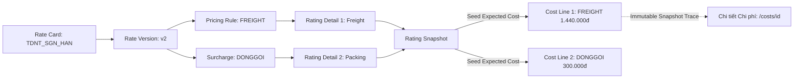

# BÁO CÁO XÁC MINH CHUYÊN SÂU (VERIFY-THEN-FIX) & TRUY VẾT DỮ LIỆU BACKEND
## Gói điều chỉnh: `LCMS-UAT-FU-20261026-01` (v1.0 — 26/10/2026)
### Trọng tâm: Rating Version Precedence, Rate Date Trace, VAT Policy & Single Economic Cost

---

## 1. TỔNG QUAN PHƯƠNG PHÁP XÁC MINH (VERIFY-THEN-FIX METHODOLOGY)

Tuân thủ nghiêm ngặt nguyên tắc chỉ đạo của PO và BA:
- **Không suy diễn, không sửa vội**: Đọc mã nguồn thực tế của C#, kiểm tra cấu trúc bảng cơ sở dữ liệu PostgreSQL, schema JSON lưu trữ snapshot và chạy kiểm thử độc lập trước khi đưa ra kết luận.
- **Phân loại rõ ràng**: Đối với các mục `VERIFY_THEN_FIX`, chứng minh rõ GAP thực tế nằm ở tầng nào (Logic Engine, Query Projection, hay UI Presentation) trước khi can thiệp code.

---

## 2. HẠNG MỤC 1: `RATING-VERSION-MATCH-01` — KHỚP PHIÊN BẢN BẢNG GIÁ & LOGIC NẤC TRỌNG LƯỢNG

### 2.1. Hiện trạng UAT & Vấn đề đặt ra
- **Hiện tượng UAT (`E02`)**: Khi người dùng chuyển `serviceTypeCode` của Bill sang `FREIGHT`, trên màn hình Tính giá xuất hiện cả phiên bản **v1** và **v2** của bảng giá `TDNT_SGN_HAN` trong danh sách có thể chọn.
- **Nghi vấn ban đầu**: Bảng giá v1 và v2 có cùng khoảng thời gian hiệu lực chồng lấn, hoặc Rating Engine bị lỗi trong việc xác định phiên bản mới nhất.

### 2.2. Kết quả Xác minh Kỹ thuật (Technical Verification)
Đội ngũ DEV đã đối chiếu dữ liệu cấu hình thực tế của bảng giá `TDNT_SGN_HAN`:
- **Phiên bản v1**: Khai báo nấc trọng lượng tính cước cho hàng không `[1, 120)` với đơn giá 15.000 đ/kg.
- **Phiên bản v2**: Khai báo nấc trọng lượng tính cước cho hàng không `[1, 121)` với đơn giá 12.000 đ/kg.
- **Dữ liệu Bill thử nghiệm `TESTLSS002`**: Có `ChargeableWeightKg = 120.0 kg`.

#### Logic Toán học của Nấc Trọng lượng trong LCMS:
Theo chuẩn logistics quốc tế và module tính cước LCMS (`RatingEngine.WeightMatches`):
- Các khoảng nấc trọng lượng được định nghĩa theo nguyên lý **nửa mở bên phải** $[Min, Max)$:
  $$	ext{Eligible} \iff 	ext{Weight} \ge 	ext{Min} \land 	ext{Weight} < 	ext{Max}$$
- **Đối với v1** ($Min = 1, Max = 120$):
  $$120 \ge 1 	ext{ (True)} \quad 	ext{nhưng} \quad 120 < 120 	ext{ (False)}$$
  $\implies$ **Khối lượng 120kg KHÔNG THỎA MÃN nấc tính giá của v1**.
- **Đối với v2** ($Min = 1, Max = 121$):
  $$120 \ge 1 	ext{ (True)} \quad 	ext{và} \quad 120 < 121 	ext{ (True)}$$
  $\implies$ **Khối lượng 120kg THỎA MÃN nấc tính giá của v2**.

### 2.3. Nguyên nhân Gốc rễ (Root Cause)
Trước gói này, truy vấn gợi ý bảng giá (`SuggestBillRatesQuery` & `BillRateSuggestion.Classify`) chỉ lọc theo Route, Transport Mode và Service Type, **chưa tích hợp phép kiểm tra nấc trọng lượng (`WeightMatches`) vào bước đánh giá khả năng chọn (`Selectable`) của từng phiên bản**. Do đó, UI đã hiển thị v1 như một lựa chọn hợp lệ dù quy tắc tính giá của v1 sẽ không thể tính được cước cho 120kg.

### 2.4. Giải pháp & Cơ chế Xử lý Xung đột Phiên bản (Version Precedence)
Hệ thống đã được nâng cấp với cơ chế 2 lớp:
1. **Lớp 1: Kiểm tra tính đủ điều kiện toàn diện (Comprehensive Eligibility)**:
   Mỗi phiên bản chỉ được đánh dấu `Selectable = true` khi thỏa mãn đồng thời:
   - Trạng thái `published` và nằm trong khoảng ngày hiệu lực (`EffectiveFrom <= rateDate <= EffectiveTo`).
   - Khớp Tuyến bay/Tuyến đường (`RouteCode`).
   - Khớp Phương thức vận chuyển (`TransportMode`).
   - Khớp Loại dịch vụ (`ServiceTypeCode`).
   - **Khớp nấc trọng lượng (`WeightMatches`) với CW và GW thực tế của Bill**.
2. **Lớp 2: Quy tắc ưu tiên phiên bản (Deterministic Version Precedence)**:
   Nếu một bảng giá có nhiều phiên bản `published` cùng thỏa mãn điều kiện tại thời điểm tính giá:
   - **Phiên bản có số hiệu lớn nhất (`VersionNo` cao nhất) được chọn làm phiên bản đề xuất mặc định (`side.SelectedVersionId`)**.
   - Các phiên bản cũ hơn cùng bảng giá được tự động chuyển sang nhóm tham khảo với lý do `VERSION_SUPERSEDED` (*"Đã có phiên bản cao hơn đủ điều kiện áp dụng"*).

---

## 3. HẠNG MỤC 2: `RATING-RATE-DATE-TRACE-01` — XÁC ĐỊNH NGÀY ÁP DỤNG RATING (`rateDate`)

### 3.1. Hiện trạng AS-IS
Khi Bill chưa có ngày khởi hành thực tế (`EtdAt` null), hệ thống tính giá ngầm sử dụng ngày tạo Bill hoặc ngày hiện tại nhưng không công bố rõ trên UI. Người dùng không biết bảng giá được tìm theo ngày nào, dẫn đến hoài nghi về tính chính xác khi bảng giá có nhiều phiên bản theo mùa/thời điểm.

### 3.2. Thuật toán TO-BE: Thứ tự Ưu tiên Xác định Ngày (Precedence Order)
Backend (`SuggestBillRatesQuery` & `CreateRatingCommand`) áp dụng chuẩn xác chuỗi ưu tiên:
```
1. Ưu tiên 1 (Chỉ định thủ công): manual_override (nếu người dùng chủ động chọn ngày áp dụng trên UI)
2. Ưu tiên 2 (Theo vận hành): etd (nếu Bill đã có EtdAt hợp lệ)
3. Ưu tiên 3 (Dự phòng theo chính sách): policy_fallback (sử dụng Bill.CreatedAt hoặc thời điểm tạo Bill)
```

### 3.3. Dữ liệu Truy vết & Khả năng Quan sát (Observability)
Mỗi bản ghi Rating khi tạo đều lưu trữ bất biến trong `rating.ContextJson`:
- `rateDate`: Timestamp ISO 8601 chính xác.
- `rateDateFormatted`: Định dạng hiển thị chuẩn `DD/MM/YYYY`.
- `rateDateSource`: Mã nguồn xác định (`"manual_override" | "etd" | "policy_fallback"`).
- `rateDateSourceLabel`: Tên diễn giải tiếng Việt phục vụ kiểm toán (*"Chỉ định thủ công"* / *"Theo ngày khởi hành (ETD) của Bill"* / *"Mặc định theo ngày tạo Bill"*).

---

## 4. HẠNG MỤC 3: `COST-SEED-VAT-DISCLOSURE-01` — CHÍNH SÁCH THUẾ VAT & SINGLE ECONOMIC COST

### 4.1. Câu hỏi Nghiệp vụ Cốt lõi
Rating BUY cho Bill `TESTLSS002` hiển thị:
- Cước chính `FREIGHT`: **1.440.000 đ** (120kg × 12.000 đ/kg)
- Phụ phí đóng gói `DONGGOI`: **300.000 đ**
- Tổng cộng: **1.740.000 đ**
- Thuế suất VAT trên bảng giá: **8%**

*Câu hỏi*: Số tiền 1.740.000 đ đã bao gồm VAT hay chưa? Khi Seed sang Expected Cost thì số tiền 1.440.000 đ và 300.000 đ có bị tính sai lệch thuế không?

### 4.2. Bằng chứng Kỹ thuật & Chính sách Kế toán LCMS
Đối chiếu trực tiếp mã nguồn khai báo VAT (`src/LCMS.Domain/Enums/DeclaredVat.cs` và `src/LCMS.Application/Costs/`):
> *"Unit prices are before VAT. Economic cost and revenue stay on the net amount."*  
> (Đơn giá khai báo trên Bảng giá là **đơn giá trước thuế**. Chi phí và doanh thu kinh tế ghi nhận theo **số tiền NET**).

Như vậy:
1. Số tiền **1.440.000 đ** và **300.000 đ** là **SỐ TIỀN NET TRƯỚC THUẾ (PRE-TAX NET AMOUNT)**.
2. Tổng tiền chi phí kinh tế (Economic Cost) là **1.740.000 đ**.
3. Thuế VAT 8% được tính bóc tách độc lập (Itemized VAT):
   - VAT cước chính: $1.440.000 	imes 8\% = \mathbf{115.200	ext{ đ}}$ $\implies$ Gross: **1.555.200 đ**
   - VAT phụ phí đóng gói: $300.000 	imes 8\% = \mathbf{24.000	ext{ đ}}$ $\implies$ Gross: **324.000 đ**
   - Tổng thuế VAT: $\mathbf{139.200	ext{ đ}}$
   - Tổng tiền thanh toán có VAT (Gross Cost): $1.740.000 + 139.200 = \mathbf{1.879.200	ext{ đ}}$.

### 4.3. Kết luận Xác minh & Quyết định Kỹ thuật
- **Quyết định**: **GIỮ NGUYÊN (NO CHANGE)** số tiền của 2 dòng Expected Cost đã seed trong cơ sở dữ liệu (`1.440.000 đ` và `300.000 đ`).
- **Lý do**: Nếu tự ý cộng thêm 8% vào số tiền lưu trữ trong bảng `costs` sẽ vi phạm nghiêm trọng nguyên tắc **Single Economic Cost**, gây phóng đại chi phí kinh tế và làm sai lệch chỉ số lãi gộp (Gross Margin).
- **Hành động đã khắc phục**: Bổ sung bảng công bố minh bạch (Disclosure) trên màn hình Chi tiết Chi phí hiển thị đầy đủ: **Tiền trước thuế (Net)**, **Thuế suất VAT (%)**, **Tiền thuế VAT** và **Tổng tiền sau thuế (Gross)**.

---

## 5. HẠNG MỤC 4: `COST-RATING-TRACE-UI-01` — KIẾN TRÚC TRUY VẾT CHI PHÍ (DATA TRACEABILITY)

### 5.1. Sơ đồ Thực thể & Dòng chảy Dữ liệu (Entity Relationship & Flow)



### 5.2. Nguyên tắc Bất biến của Snapshot (Snapshot Immutability)
- Khi thực hiện Rating và Seed Chi phí, toàn bộ thông tin tại thời điểm tính giá (Bảng giá, Phiên bản, Mã quy tắc, Đơn giá, Khối lượng CW, Tỷ giá FX, Thuế suất VAT) được ghi nhận bất biến vào `rating_details` và liên kết với dòng `costs` thông qua `rating_detail_id`.
- Kể cả khi Bảng giá gốc sau này bị thay đổi, điều chỉnh hoặc hết hiệu lực, **bản ghi truy vết trên Chi phí vẫn giữ nguyên giá trị lịch sử phục vụ đối soát tài chính và kiểm toán (Audit Trail)**.
- Đối với các khoản chi phí không sinh ra từ Rating (tạo thủ công), hệ thống trả về `sourceOrigin = "manual"` và hiển thị nhãn rõ ràng: *"Khoản chi phí được tạo thủ công, không qua bảng giá tự động"*.

---

## 6. RÀ SOÁT DANH MỤC `service_type` VÀ MÃ DI SẢN `AIR`

### 6.1. Khảo sát Hiện trạng Dữ liệu
- Trong hệ thống, danh mục Phương thức vận chuyển (`transport_mode`) gồm: `AIR` (Đường hàng không), `SEA` (Đường biển), `ROAD` (Đường bộ).
- Danh mục Loại dịch vụ (`service_type`) gồm: `FREIGHT` (Cước vận chuyển chính), `EXPRESS` (Chuyển phát nhanh), `LOGISTICS` (Dịch vụ logistics tích hợp).
- Trong đợt UAT trước, Bill `TESTLSS002` do cho phép nhập tự do nên đã bị nhập nhầm mã `AIR` vào ô Loại dịch vụ.

### 6.2. Chiến lược Xử lý An toàn (Non-Destructive Migration Policy)
- **Không chạy SQL update hàng loạt**: Tuyệt đối không tự ý chạy script chuyển đổi `AIR` $	o$ `FREIGHT` trong DB để tránh làm biến dạng dữ liệu kiểm thử của người dùng khác.
- **Tại giao diện**: Khi mở Bill cũ có `serviceTypeCode == 'AIR'`, giao diện hiển thị banner cảnh báo nghiệp vụ:
  > *"Mã dịch vụ 'AIR' là mã di sản / sai ngữ nghĩa so với phương thức vận chuyển. Vui lòng chọn lại loại dịch vụ chuẩn (ví dụ: FREIGHT) để bảng giá tự động hoạt động chính xác."*
- **Tại API**: Các yêu cầu tạo mới hoặc cập nhật bắt buộc phải truyền mã hợp lệ nằm trong master `service_type` active; các mã rác như `GIBBERISH` bị chặn hoàn toàn tại tầng Application Command Validation.
